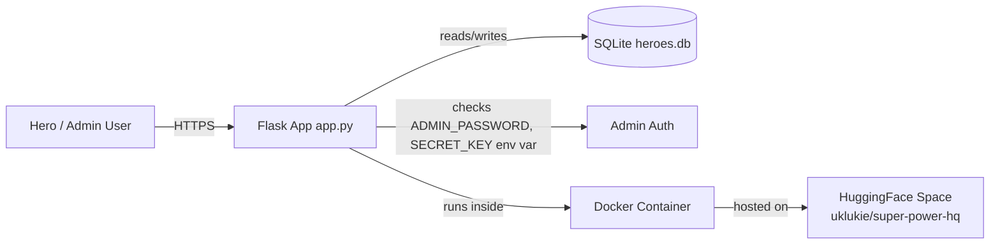
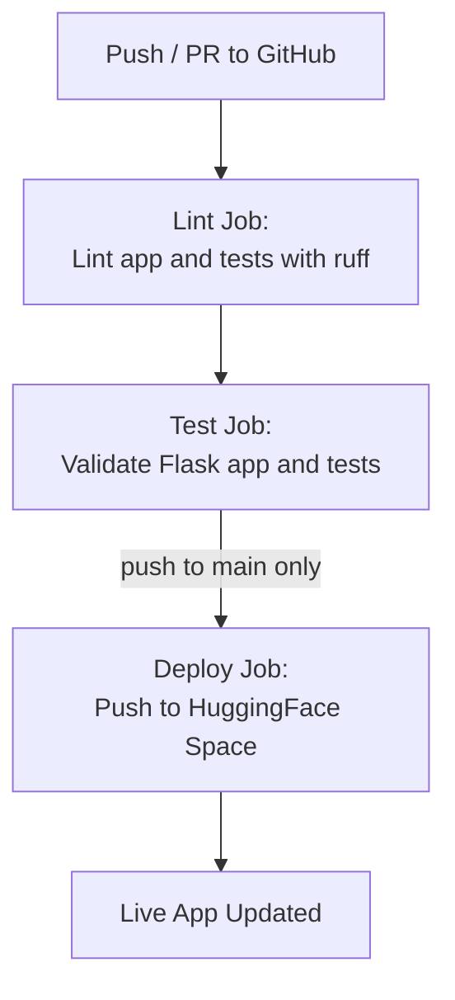

# Super Power HQ

A hero registration and admin review app built with Flask. Visitors can submit applications; administrators can review submissions and download them as CSV.

## Run locally

Requires Python 3.12+.

```bash
python -m venv .venv
source .venv/bin/activate  # On Windows: .venv\Scripts\activate
pip install -r requirements.txt
export ADMIN_PASSWORD='choose-a-password'
export SECRET_KEY='choose-a-long-random-secret'
flask --app app run --debug
```

Open `http://localhost:5000`. Without `DATABASE_URL`, the app uses the repository's `heroes.db` SQLite file for local development.

## Deploy to Vercel

The root `app.py` exports a Flask WSGI application as `app`, which Vercel can detect. No external database setup is required: on Vercel the app copies the bundled `heroes.db` to `/tmp` and uses SQLite there.

1. Import this repository into Vercel and set the project root to the repository root.
2. Add `ADMIN_PASSWORD` and a separate long, random `SECRET_KEY` to the Vercel project environment variables if you want to use the admin page.
3. Redeploy, then visit `/` to submit applications and `/admin` to review them.

**Persistence limitation:** Vercel's `/tmp` storage is temporary and local to a serverless instance. New submissions can disappear after an instance restarts, and concurrent Vercel instances may not see the same SQLite changes. The bundled database provides the initial SQLite contents, but Vercel cannot durably update that repository file. For reliable shared persistence, the app must use a durable database or a host with a persistent disk.

## Docker / Hugging Face Spaces

The included `Dockerfile` runs the Flask app with Gunicorn on port 7860. Set `ADMIN_PASSWORD` and `SECRET_KEY` in the hosting environment. For persistent submissions, also set `DATABASE_URL` to PostgreSQL; container-local SQLite data can be lost when an instance is replaced.

The GitHub Actions workflow runs lint and application tests, then pushes to the configured Hugging Face Space on pushes to `main`. Set the `HF_TOKEN` GitHub secret if you use that deployment.

## Architecture

<!-- ARCHITECTURE-DIAGRAM:START -->
### System Design



### CI/CD Flow



*Diagrams above are auto-generated from the repo's code and CI workflow -- see [`scripts/generate_architecture_diagram.py`](scripts/generate_architecture_diagram.py).*
<!-- ARCHITECTURE-DIAGRAM:END -->

## Database schema

The `submissions` table uses an auto-incrementing `id` and stores `hero_name`, `powers`, `age`, `location`, and `email`. `heroes.db` is used for local development; production Vercel deployments should use PostgreSQL.

## Application behavior

- Sign-up validates hero name, powers, age (1–150), location, and email on the server.
- Admin review at `/admin` requires `ADMIN_PASSWORD` and a configured `SECRET_KEY`.
- Admins can download submissions from the review page as CSV.
- Jinja autoescaping is enabled for rendered form values; database statements use SQLAlchemy's bound parameters.
- Local development uses `heroes.db`; Vercel uses a writable temporary SQLite copy at `/tmp/heroes.db`.

## Tests

```bash
python -m unittest discover -s tests
```
